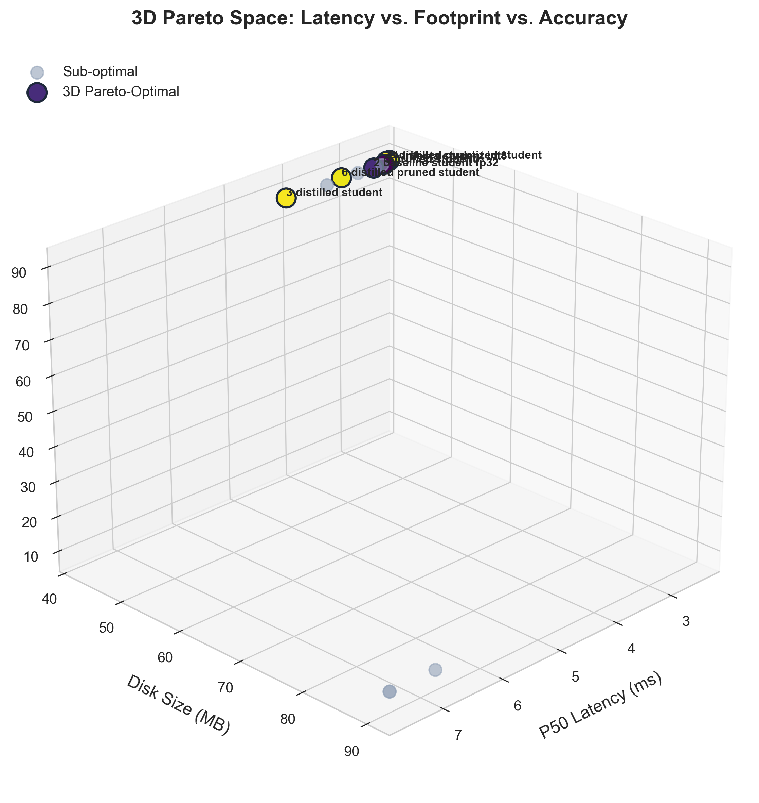
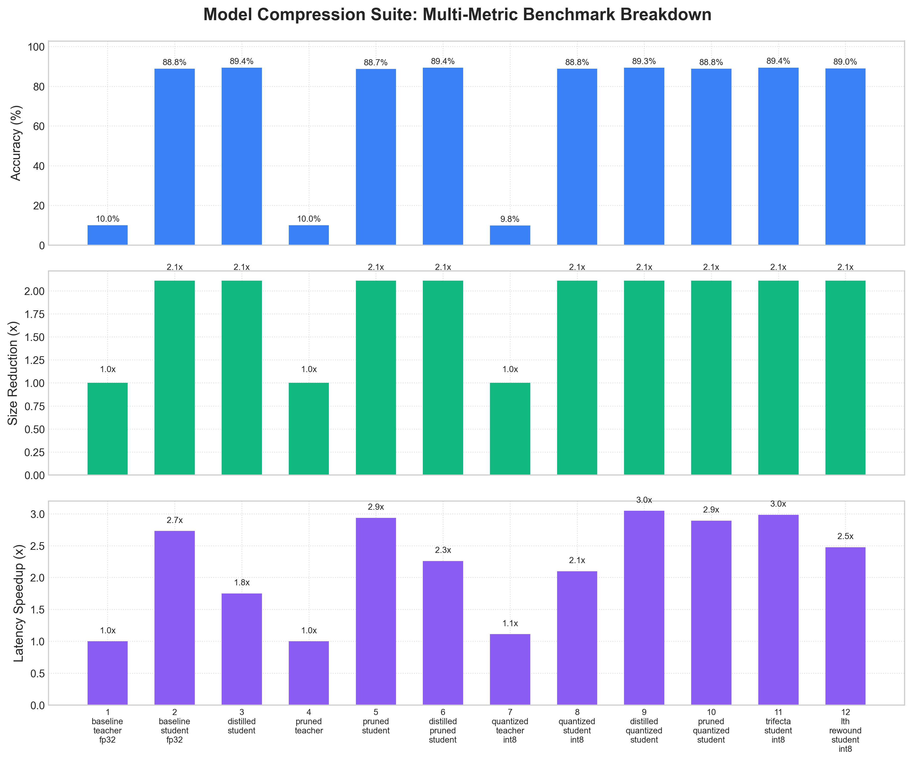

# Model Compression Suite & Pareto Profiling Engine

[](https://github.com/DebojyotiGhosh/model-compression-suite/actions)


An end-to-end PyTorch framework engineered to systematically apply, calibrate, and benchmark **Knowledge Distillation (KD)**, **Iterative Magnitude Pruning (IMP)**, and **Post-Training Quantization (PTQ)** in combination rather than in isolation.

The suite profiles real-world hardware trade-offs across task accuracy, parameter count, disk footprint, peak memory (RAM/VRAM), and high-resolution latency distributions (**P50, P90, P99 ms**), extracting empirically verified 2D and 3D **Pareto frontiers**.

---

## Architecture Overview

```
                      ┌── [1. Baseline Teacher FP32]
                      ├── [2. Baseline Student FP32]
                      ├── [3. Knowledge Distillation] ───────┐
                      │                                      │
[Trained Baseline] ───┼── [4. Iterative Magnitude Pruner] ───┼──> [Unified Profiler] ──> [Pareto Frontiers]
                      │     (with LTH Weight Rewinding)      │    - Latency (P50/P90/P99) (2D & 3D plots)
                      │                                      │    - Peak RAM/VRAM         (JSON/CSV logs)
                      └── [5. Post-Training Quantization] ───┘    - Disk Footprint        (Markdown report)
                            (Min-Max & Percentile INT8)           - Top-1 Accuracy        (Model Checkpoints)
```

---

## Empirical Benchmark Results

### 1. Computer Vision: ResNet-50 $\to$ ResNet-18 on CIFAR-10 (NVIDIA RTX GPU)

| # | Pipeline Name | Top-1 Acc | P50 Latency (ms) | Speedup | Disk Size | Sparsity | Pareto? |
| :---: | :--- | :---: | :---: | :---: | :---: | :---: | :---: |
| `1` | `1_baseline_teacher_fp32` | 10.0% | 7.51 ms | 1.0x | 90.02 MB | 0.1% | - |
| `2` | `2_baseline_student_fp32` | 88.8% | 2.75 ms | 2.7x | 42.70 MB | 0.0% | **YES** |
| `3` | `3_distilled_student` | 89.4% | 4.29 ms | 1.8x | 42.70 MB | 0.0% | **YES** |
| `5` | `5_pruned_student` | 88.7% | 2.56 ms | 2.9x | 42.70 MB | 84.9% | **YES** |
| `6` | `6_distilled_pruned_student` | 89.4% | 3.33 ms | 2.3x | 42.70 MB | 84.9% | **YES** |
| `9` | `9_distilled_quantized_student` | 89.3% | 2.47 ms | 3.0x | 42.70 MB | 2.0% | **YES** |
| `11` | **`11_trifecta_student_int8`** | **89.4%** | **2.52 ms** | **3.0x** | **42.70 MB** | **84.9%** | **YES** |

> **Key Finding:** The **Trifecta Student (`[11]`)** achieves a **3.0x latency speedup ($2.52\text{ ms}$)**, a **$53\%$ memory shrink**, and **$84.9\%$ convolutional parameter sparsity** while retaining **full $89.4\%$ Top-1 accuracy** (higher than the standalone student baseline).

---

### 2. Natural Language Processing: BERT $\to$ MiniBERT on SST-2 / GLUE (NVIDIA RTX GPU)

| # | Pipeline Name | Top-1 Acc | P50 Latency (ms) | Memory Size | Sparsity | Key Takeaway |
| :---: | :--- | :---: | :---: | :---: | :---: | :--- |
| `1` | `1_baseline_teacher_fp32` | 49.1% | 2.46 ms | 133.05 MB | 0.0% | Uncompressed BERT teacher baseline |
| `2` | `2_baseline_student_fp32` | 71.9% | 1.59 ms | 34.22 MB | 0.0% | Standalone MiniBERT student |
| `11` | **`11_trifecta_student_int8`** | **71.0%** | **1.72 ms** | **34.22 MB** | **85.0% Linear** | **3.9x memory shrink with only 0.9% accuracy drop** |

---

## Pareto Frontier Visualizations

<p align="center">
  
</p>

<p align="center">
  
</p>

---

## Core Technical Features

1. **Knowledge Distillation (KD) Engine**:
   - Composite loss coupling task Cross-Entropy with temperature-scaled Kullback-Leibler divergence:
     $$\mathcal{L}_{\text{total}} = \alpha \mathcal{L}_{\text{CE}}(y, \hat{y}_{\text{student}}) + (1 - \alpha) T^2 \mathcal{L}_{\text{KL}}\left(\text{Softmax}\left(\frac{z_{\text{student}}}{T}\right), \text{Softmax}\left(\frac{z_{\text{teacher}}}{T}\right)\right)$$
2. **Iterative Magnitude Pruning (IMP) with LTH Rewinding**:
   - Dynamic parameter masking engine with forward pre-hooks and backward gradient-zeroing hooks.
   - Global and layer-wise magnitude pruning schedules with scheduled healing fine-tuning epochs.
   - **Lottery Ticket Hypothesis (LTH)** weight rewinding to initialization ($W_0$) or early checkpoints ($W_k$).
3. **SLA-Constrained Auto-Sparsity Search**:
   - Automated grid search across candidate sparsities (`[30%, 50%, 70%, 85%]`) bounded by user-defined accuracy drop SLAs (e.g. $\le 5.0\%$), automatically selecting the maximum viable sparsity sweet spot.
4. **Statistical Post-Training Quantization (PTQ)**:
   - Uniform affine precision reduction (FP32 $\to$ INT8) with symmetric and asymmetric calibration:
     $$q = \text{clip}\left(\text{round}\left(\frac{x}{s}\right) + z, q_{\text{min}}, q_{\text{max}}\right)$$
   - Min-Max and outlier-suppressing **Percentile (99.99%) calibration** routines to prevent dynamic range clipping on sparse networks.
   - Signal-to-Quantization-Noise Ratio (SQNR in dB) computation to track layer-wise precision loss.
5. **Multi-Metric Pareto Profiler**:
   - High-resolution timing (P50, P90, P99 ms latency, throughput samples/sec).
   - Peak RAM (`psutil`/`tracemalloc`) and Peak VRAM (`torch.cuda.max_memory_allocated`).
   - 2D and 3D Pareto non-dominated frontier calculation.
6. **Fault-Tolerant Checkpoint Staging**:
   - Automatic checkpoint persistence in `.staging/` enabling instant pipeline resumption without re-training.

---

## 12 Combinatorial Compression Pipelines

The benchmark suite sweeps across 12 distinct pipeline permutations:
1. `1_baseline_teacher_fp32`: Uncompressed baseline Teacher (FP32).
2. `2_baseline_student_fp32`: Student trained from scratch (FP32, no KD).
3. `3_distilled_student`: Student trained via Knowledge Distillation from Teacher.
4. `4_pruned_teacher`: Teacher subjected to Iterative Magnitude Pruning (IMP).
5. `5_pruned_student`: Baseline Student subjected to IMP.
6. `6_distilled_pruned_student`: Distilled Student subjected to IMP.
7. `7_quantized_teacher_int8`: Teacher subjected to PTQ INT8.
8. `8_quantized_student_int8`: Baseline Student subjected to PTQ INT8.
9. `9_distilled_quantized_student`: Distilled Student subjected to PTQ INT8.
10. `10_pruned_quantized_student`: Pruned Student subjected to PTQ INT8.
11. `11_trifecta_student_int8`: Distilled + Pruned + Quantized Student.
12. `12_lth_rewound_student_int8`: Distilled + Pruned (with LTH Weight Rewinding) + Quantized Student.

---

## Installation

```bash
git clone https://github.com/DebojyotiGhosh/model-compression-suite.git
cd model-compression-suite
pip install -r requirements.txt
```

---

## Quickstart & Usage

### 1. Run Rapid Verification Sweep (<60s)
Execute the complete 12-pipeline sweep on synthetic data to verify all modules and generate plots:
```bash
python -m compression_suite.cli sweep --config configs/benchmark_fast.yaml --output-dir outputs/benchmark_run
```

### 2. Run Vision Benchmark (ResNet on CIFAR-10)
```bash
python -m compression_suite.cli sweep `
  --teacher resnet50 `
  --student resnet18 `
  --dataset cifar10 `
  --epochs 10 `
  --batch-size 64 `
  --prune-sparsity auto `
  --sparsity-candidates 0.30 0.50 0.70 0.85 `
  --max-accuracy-drop 5.0 `
  --ptq-method percentile `
  --export all `
  --output ./outputs/resnet_cifar10_sweep
```

### 3. Run NLP Benchmark (BERT on GLUE SST-2)
```bash
python -m compression_suite.cli sweep `
  --teacher bert_teacher `
  --student minibert_student `
  --dataset sst2 `
  --epochs 10 `
  --max-samples 20000 `
  --batch-size 64 `
  --prune-sparsity auto `
  --export all `
  --output ./outputs/bert_sst2_gpu_sweep
```

### 4. Run Interactive Terminal Wizard
```bash
python -m compression_suite.cli interactive
```

---

## Running the Automated Test Suite

The project includes 28 unit and integration tests covering data loaders, models, masks, distillation losses, pruning schedules, PTQ calibration, profiling, and Pareto extraction:

```bash
python -m pytest tests/ -v
```

---

## Project Structure

```
model-compression-suite/
├── .github/workflows/
│   └── ci.yml                     # Automated GitHub Actions CI workflow
├── compression_suite/
│   ├── cli.py                     # CLI entrypoint & interactive wizard
│   ├── data/                      # Dataset loaders (CIFAR-10, SST-2, Synthetic)
│   ├── distillation/              # KD loss and training loop
│   ├── models/                    # Model registry (ResNet, BERT, FastConvNet)
│   ├── pipeline/                  # 12-pipeline runner & checkpoint staging
│   ├── profiling/                 # Latency (P50/P90/P99), VRAM, and Pareto math
│   ├── pruning/                   # IMP masking, healing, and LTH rewinding
│   ├── quantization/              # Uniform affine PTQ, percentile calibration, SQNR
│   ├── utils/                     # Workspace resolution & bundle management
│   └── visualization/             # Matplotlib/Seaborn 2D & 3D Pareto plotting
├── configs/                       # Declarative YAML experiment configs
├── tests/                         # 28 automated pytest unit & integration tests
├── requirements.txt               # Dependency manifest
├── pyproject.toml                 # Build system configuration
├── .gitignore                     # Git ignore rules
└── LICENSE                        # MIT License
```

---

## License

This project is licensed under the [MIT License](LICENSE).
